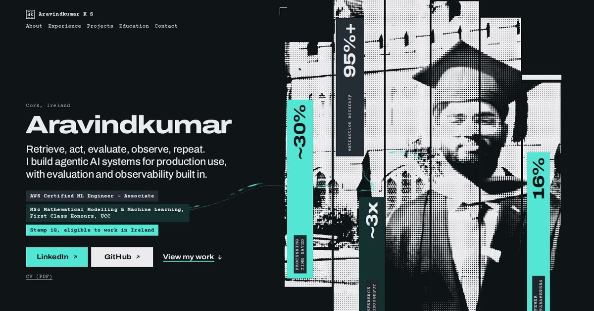

# Aravindkumar K S — portfolio



This is my personal portfolio, live at [akornero.github.io](https://akornero.github.io/). I'm an AI/ML engineer in Cork, Ireland, and I built the site to show my work the way I'd want to read it as a reviewer: what I built, how I checked it, and what came of it. It is written for recruiters who have ten seconds and hiring managers who have ten minutes.

## Technologies

- **HTML, CSS and JavaScript**, with no framework and no build step. The site runs from disk or any static host.
- **GSAP 3.15** (ScrollTrigger, SplitText, Flip) and **Lenis 1.3** for motion and smooth scrolling, vendored in `vendor/` rather than loaded from a CDN.
- **Archivo and Courier Prime**, self-hosted in `fonts/` under the SIL Open Font License, so visitors' browsers make no requests to Google.
- **AVIF and WebP** photos in several sizes, served through `<picture>` with JPEG fallbacks.
- **Terraform** (AWS provider 5.x) for an S3 + CloudFront + ACM + Route 53 setup, kept in `IaC/`.
- **GitHub Actions** for deployment, signing in to AWS through OIDC instead of stored keys.

## Features

- A hero that answers the recruiter's questions first: who I am, what I do, where I am, and that I can work in Ireland without sponsorship.
- Six project case studies, each told as Problem → Built → Hard part → Result, with the less central two behind "Show more".
- Light and dark themes that follow the system setting, with a toggle that wipes the new theme in from the button you pressed.
- A slim navigation bar that slides in when the mouse nears the top of the page, underlining the section in view.
- A themed cursor on mouse and trackpad devices.
- Motion that is entirely optional: the page is complete without JavaScript, and visitors who prefer reduced motion get none.
- Search and AI discovery: Open Graph and Twitter cards, JSON-LD (`ProfilePage` → `Person`), `sitemap.xml`, `robots.txt` that welcomes AI crawlers, and an `llms.txt` summary.
- Custom 404 and 403 pages.

## The process

I started by exploring a few design directions against a moodboard, and settled on a print-inspired look: halftone photo strips, paper colours and a mono typeface for labels. The site began in its own folder and moved to the repository root once it became the real thing.

From there I worked in passes: copy first, written from my CV and never embellished, then layout, then motion as a separate layer that the page does not depend on. I ran design reviews and an accessibility audit along the way, and later a Lighthouse report, fixing what they found: image sizes, a font that loaded late, and an ARIA attribute the animation library added where it isn't allowed.

For hosting I first wrote Terraform for S3 and CloudFront with a GitHub Actions deploy, then moved to GitHub Pages. I kept the AWS setup in `IaC/` so I can switch back.

## What I learned

- **S3 behind CloudFront answers a missing file with 403, not 404**, unless CloudFront is also allowed to list the bucket. Granting `s3:ListBucket` to the distribution is what makes a real 404 page possible.
- **GitHub's OIDC subject can include numeric IDs** (`repo:owner@id/name@id:…`), so an IAM trust policy written for `repo:owner/name` silently rejects the deploy. CloudTrail showed the exact claim GitHub sent.
- **Text-splitting animations change the markup.** SplitText added an `aria-label` to paragraphs, which ARIA forbids, and dropped a non-breaking space I relied on. Both needed explicit options.
- **Responsive images need honest `sizes` values.** Measuring the rendered widths showed the browser was downloading images up to twice as large as needed.

## Running the project

The site is static, so any local web server works:

```bash
git clone https://github.com/AkorNero/AkorNero.github.io.git
cd AkorNero.github.io
python3 -m http.server 8000
```

Then open <http://localhost:8000>. Opening `index.html` directly also works, but a server is closer to how it runs in production.

**Deployment.** The site is currently published with GitHub Pages from the `main` branch.

To deploy to AWS instead:

1. Copy `IaC/backend.hcl.example` to `IaC/backend.hcl` and set your state bucket.
2. Put your values (domain, hosted zone, GitHub repository) in a `.tfvars` file. These files are git-ignored.
3. Run the following:

   ```bash
   cd IaC
   terraform init -backend-config=backend.hcl
   terraform apply -var-file=<your>.tfvars
   ```

4. Add the outputs as repository secrets: `AWS_ROLE_ARN`, `S3_BUCKET`, `CLOUDFRONT_DISTRIBUTION_ID` and `AWS_REGION`.
5. Enable the **Deploy site** workflow.

From then on, every push to `main` uploads the site to S3 and invalidates the CloudFront cache.
